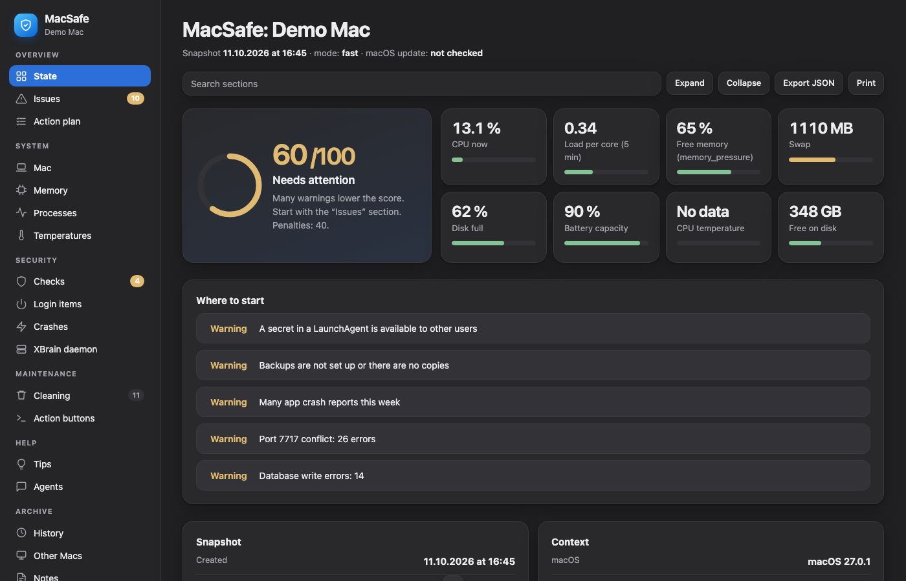
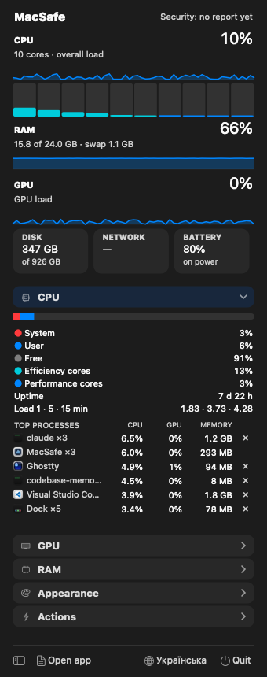
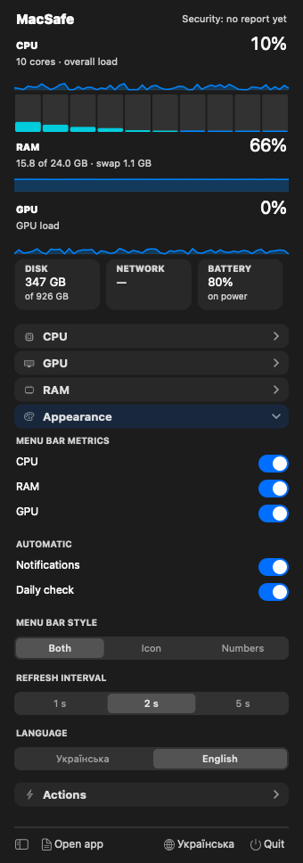
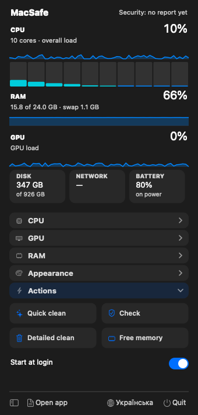

# MacSafe

A macOS menu bar monitor, a security report, and a safe cache cleaner in one small app.

- **Menu bar:** CPU, memory, GPU, disk, network and battery at a glance, with a popover for details, the process list and quick actions.
- **Report window:** a security and health report with an issue list, an action plan, history, and a cleaning panel.
- **Safe by design:** no root, no system changes. It deletes only caches and old logs, and anything it removes goes to the Trash first.
- **English by default, and Ukrainian:** switch the language in the menu bar popover (Appearance) or in the report window (Settings).



<table>
  <tr>
    <td></td>
    <td></td>
    <td></td>
  </tr>
</table>

## Features

**Menu bar and popover**
- Live CPU, memory, GPU, disk, network and battery values, with 60-second history graphs.
- Per-core load, process groups by CPU and memory, with the ability to quit a process (asks for a second click to confirm).
- Choose which values show in the menu bar, the style (icon and numbers, icon only, numbers only), and the refresh interval (1, 2 or 5 seconds).
- Quick clean of safe caches, a free-memory action (asks for the administrator password), and start at login.

**Report**
- Security checks without root or Full Disk Access: FileVault, firewall, stealth mode, SIP, Gatekeeper, listening ports, system extensions, login items, XProtect version.
- Health checks: memory pressure, swap, disk fullness, battery health, uptime, crash reports, kernel panics, Time Machine status.
- A score with the issues ordered by urgency, each with evidence, the reason it matters, the steps, and how to verify it.
- Changes since the previous report, a score trend, and a calendar of past reports.

**Maintenance**
- **Cleaning:** choose caches by category (developer tools, logs, app caches) and by age (7, 30 or 90 days). The panel shows memory before and after.
- **Large files:** search the home folder (outside `~/Library`) and show files in Finder or move them to the Trash.
- **Leftovers:** folders from apps that are no longer installed. Selected items go to the Trash.

**Alerts**
- Notifications for sustained high memory use, low free disk space, and low battery.
- Notifications for new LaunchAgents and LaunchDaemons (checked every 10 minutes against a saved baseline).
- A daily security check, when no report exists for the day.

See [docs/modes.md](docs/modes.md) for every section and what it shows.

## Requirements

- macOS on Apple silicon. Developed and tested on macOS 27.
- Xcode Command Line Tools, to build the app (see [docs/building.md](docs/building.md)).

## Install

Build the app and install it into `/Applications`:

```sh
./build_app.sh --install
```

Open **MacSafe** from Applications. The icon appears in the menu bar, and the report window opens on the first launch.

The app is signed ad hoc. That is enough on the Mac that built it. On other Macs, macOS will warn about an unidentified developer until the app is signed with a Developer ID and notarized. See [docs/building.md](docs/building.md).

## Language

English is the default. To switch to **Українська**:

- in the menu bar popover, open **Appearance**, then **Language**. The menu bar restarts itself to apply the change;
- or in the report window, open **Settings** (last in the sidebar) and pick the language. The menu bar follows.

Details are in [docs/languages.md](docs/languages.md).

## Your data

MacSafe keeps its data in `~/Library/Application Support/MacSafe`: HTML and JSON reports, history, settings, and the autostart baseline. Nothing is sent over the network. The Agents section copies commands for you to run yourself in Terminal.

## Documentation

- [Modes and sections](docs/modes.md): what each section shows and how to use it.
- [How it works](docs/how-it-works.md): the components, data flow, and report generation.
- [Safety](docs/safety.md): what MacSafe can and cannot change, and how deletion is limited.
- [Languages](docs/languages.md): how the translation works and how to add a language.
- [Building and distribution](docs/building.md): build, install, signing, and the DMG.
- [Design references](docs/design-references.md): the apps and sources used for the interface.

## Development

```sh
python3 -m unittest discover -s tests
```

The tests cover cleaning rules, alerts, persistence, large files, leftovers, the Trash targets, the preferences, and translation coverage. Code comments and docstrings are in English.

## Limitations

- CPU and GPU temperatures are not readable without root on Apple silicon. The Temperatures section shows what macOS exposes and marks the rest as unavailable.
- Notarization is not done yet. It needs an Apple Developer ID.
- The report is generated by a shell script and an HTML template. Its check names and report texts are translated through the dictionary in the template, so a new text needs a new entry there.

## License

MIT. See [LICENSE](LICENSE). You may use, copy and change the code, but keep the copyright notice in every copy.
